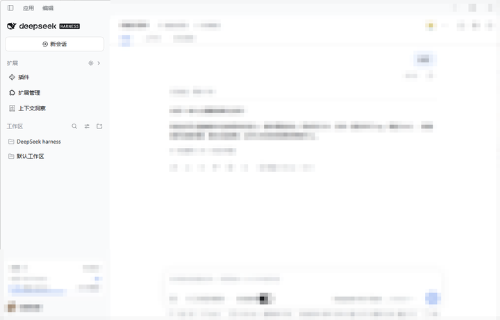
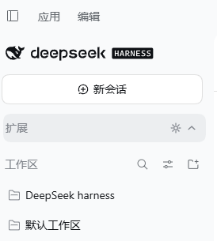
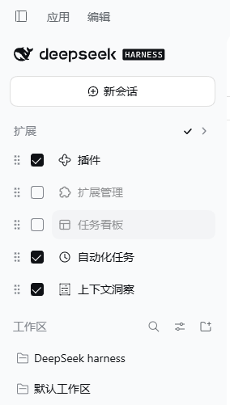

# dsh-sidebar-manager

[](https://github.com/deepseek-ai)
[](./LICENSE)
[](./test/client.test.js)

给 DeepSeek Harness 侧栏加一个**分组标题行**，用它把「全局面板」那串扩展入口折叠起来；标题右侧的齿轮进入编辑模式，逐个勾选要显示的侧栏扩展与视图标签，并支持拖拽排序。

插件装多了以后，侧栏会被挤成一长列。DSH 自带的「收起侧栏」是整个左栏一起隐藏——工作区和会话列表也一起没了。这个插件只针对**扩展入口**这一组，其余部分保持原样。

> 本仓库是 [nico-zhuang/dsh-sidebar-nav-collapse](https://github.com/nico-zhuang/dsh-sidebar-nav-collapse) 的本地维护分支，在 v0.1.0 基础上重写了交互与视觉，使其与 DSH 原生侧栏的排版、配色、字号一致。

## 效果

<table>
<tr>
<td align="center"><br><sub><b>展开</b>：标题行 + 全部扩展入口</sub></td>
<td align="center"><br><sub><b>折叠</b>：入口收起，标题行保留</sub></td>
<td align="center"><br><sub><b>编辑</b>：勾选框 + 拖拽手柄</sub></td>
</tr>
</table>

编辑态下未勾选的「任务看板」显示为灰色：**已隐藏的项在编辑模式下仍然可见**，否则勾掉就再也勾不回来。退出编辑后它才真正从列表消失，位子让给下面的入口。

## 功能

- **折叠一组入口**：点击标题行收起/展开下方的扩展入口。状态存 `localStorage`，刷新后保持。
- **逐个显示/隐藏**：齿轮进入编辑模式，每个侧栏扩展前出现勾选框。已隐藏的项在编辑模式下**仍然可见**，否则勾掉就再也勾不回来。
- **视图标签同样可管**：主内容区顶部的视图标签（画廊、编队等）也在管理范围内，规则与侧栏一致。
- **拖拽排序**：编辑模式下按住拖拽手柄即可调整顺序，侧栏纵向、标签横向各自独立。松手即生效，没有「确定 / 取消」。
- **键盘可达**：标题行是真正的 `button`，`Enter`/`Space` 折叠，`Escape` 退出编辑模式。
- **恢复干净**：禁用插件后宿主 DOM 与样式完全还原。
- **跟随主题**：配色与字号全部取自宿主的 `--dsw-*` 设计变量，主题切换时自动跟随。

### 几条刻意的取舍

- **「对话」标签不可隐藏**：它是宿主的兜底视图，隐藏后中心区会空白，因此固定为常显。
- **当前视图不能隐藏**：正在看的标签被勾掉时会弹回并提示，避免页面变空。
- **编辑模式下不能折叠**：折叠会把勾选框全藏起来，齿轮显示为「已按下」却无处可点。进入编辑时会自动展开，退出时恢复原来的折叠状态。
- **没有「未保存」状态**：每次勾选和拖拽都立即写入，所以不存在忘记保存，`Escape` 只负责退出编辑。

## 安装

```bash
# 从本仓库安装（推荐，锁定 tag）
dsh plugin --profile desktop add 'github:zuojinxin/dsh-sidebar-manager#v0.8.0'
```

安装后需**重启 DSH 桌面版**才会生效。

插件无安装脚本、无新增运行时依赖，peer 依赖只有宿主提供的 `@deepseek-ai/cordis`。

## 兼容性

- 面向 **DeepSeek Harness 0.2.1-rc.2** 开发与验证。
- 插件依赖宿主 DOM 里 `panelList` / `panelRow` 等 CSS Module 类名片段，以及 `aria-label` 为「全局面板」/「Global panels」的容器。**DSH 升级后可能需要重新适配**，这是所有非官方 UI 插件共同的风险。
- 只改动「全局面板」这一组导航，其他导航区域不受影响。

## 数据存储

状态存放在当前页面的 `localStorage`，单一版本化键：

```json
{ "v": 1, "folded": false, "hidden": ["任务看板"], "views": ["上下页"] }
```

- 早期版本分散在 `:folded` / `:hidden` / `:views` 三个键，首次启动会自动迁移并合并。
- 记录版本号高于当前插件时会被忽略而不是半读，损坏的记录同样不会让侧栏崩溃。

## 开发

```bash
# 运行测试（50 条，基于 jsdom）
npm install --no-save jsdom
node --test test/client.test.js
```

测试通过 `SNC_JSDOM` 环境变量指定 jsdom 路径，也可以直接 `npm test`（需要本地有 jsdom）。

源码结构：

| 文件 | 作用 |
| --- | --- |
| `lib/index.js` | 宿主侧入口，仅声明插件 |
| `lib/client.js` | 全部实现：样式注入、DOM 包裹、状态管理、拖拽 |
| `cordis.patch.yml` | 把插件插进宿主 bundle |

`lib/client.js` 里 CSS 是一段模板字符串常量，改动样式后需要确认大括号配平。

## 许可

[MIT](./LICENSE)

原项目由 [nico-zhuang](https://github.com/nico-zhuang) 创建。
